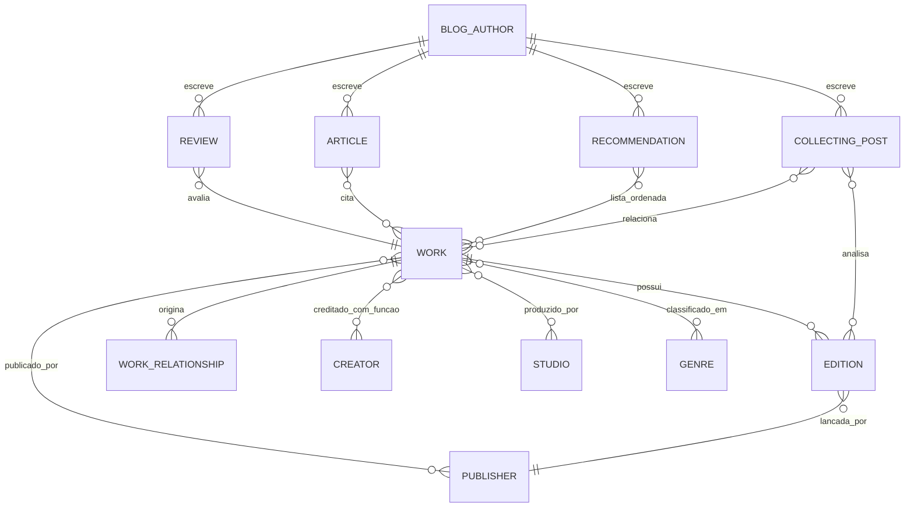

# Arquitetura e Modelo de Domínio — Mangá Atlas

- **Fase**: 02
- **Data**: 2026-11-23

## 1. Fronteiras e dependências permitidas

- `src/pages/*` → pode importar de `src/features/*` e `src/shared/*`.
- `src/features/<area>/*` → pode importar de `src/shared/*` e contratos públicos de outras features (evitando ciclos).
- `src/shared/*` → não pode importar de `src/pages/*` nem de `src/features/*`.
- **Aliases**: `@/*` (`./src/*`), `@features/*` (`./src/features/*`), `@shared/*` (`./src/shared/*`).

## 2. Diagrama de Entidade-Relacionamento

## 3. Dicionário de dados e invariantes

- **Identidade**: `id` estável e único por coleção; `slug` canônico (`[a-z0-9-]`). Campos desconhecidos permanecem `undefined` (nunca string vazia ou valor inventado).
- **Separação criador vs autor editorial**: `Creator` representa autor/ilustrador/diretor da obra; `BlogAuthor` representa quem escreve os textos do Mangá Atlas.
- **Notas (`RatingScore`)**: opcional (`0` a `5` em passos de `0.5`, ou `undefined`).
- **Relações entre obras (`WorkRelationship`)**:
  - Proibido autolink (`fromWorkId === toWorkId`).
  - Proibida duplicata `(fromWorkId, toWorkId, type)`.
  - Proibida referência órfã (ID inexistente no catálogo).
  - Ciclos inválidos em relações hierárquicas/temporais (`prequel`, `sequel`) são rejeitados; ciclos simétricos de associação (`related`) são permitidos.
- **Rotas canônicas**: `/`, `/obras/[slug]/`, `/reviews/[slug]/`, `/artigos/[slug]/`, `/guias/[slug]/`, `/colecionismo/[slug]/`, `/criadores/[slug]/`, `/editoras/[slug]/`, `/estudios/[slug]/`, `/tags/[slug]/`, `/busca/`, `/sobre/`, `/politica-editorial/`, `/contato/`.
